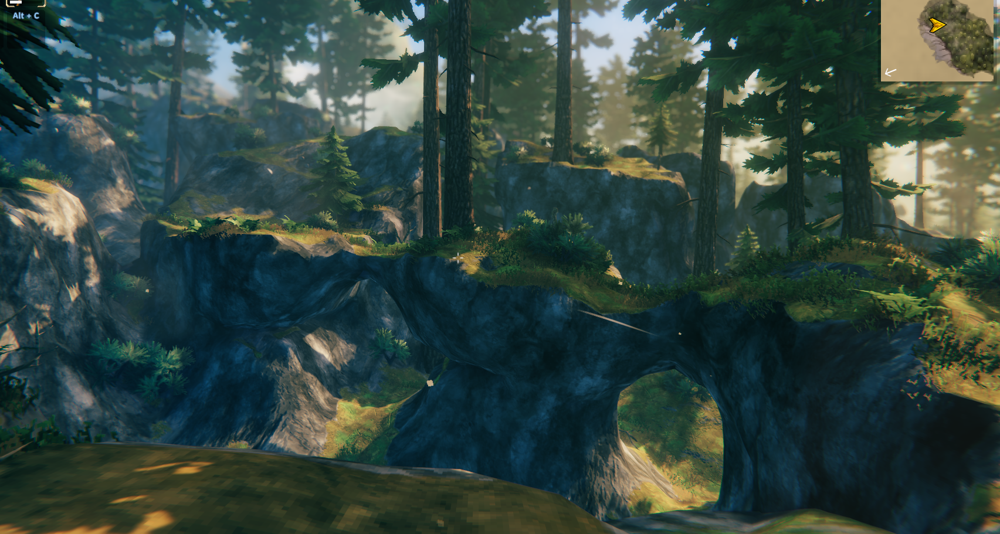
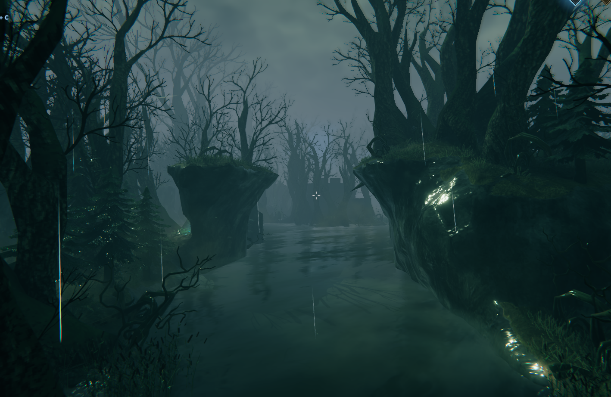
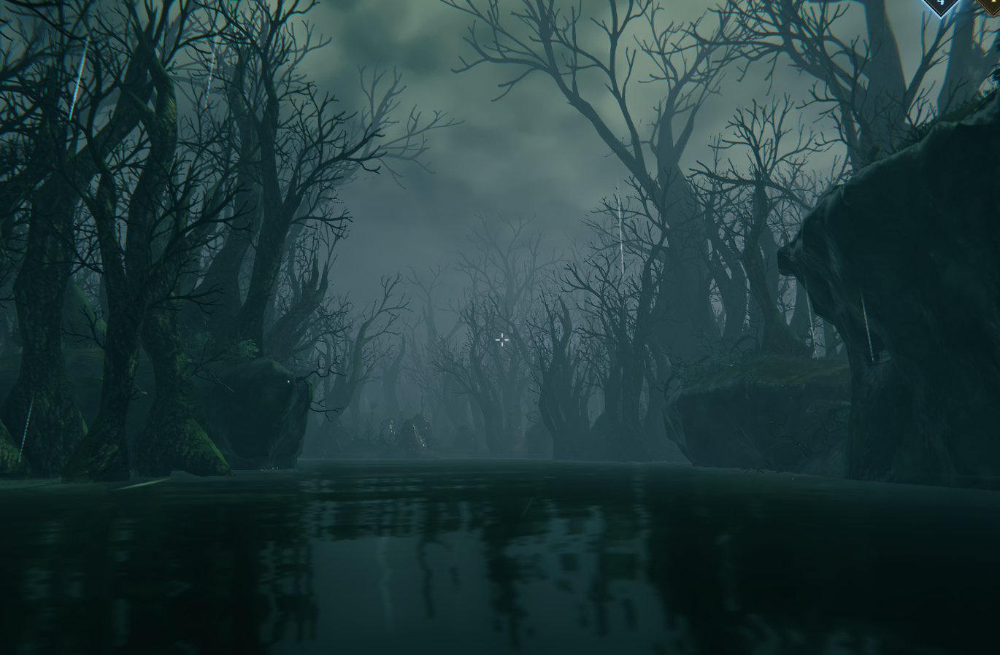
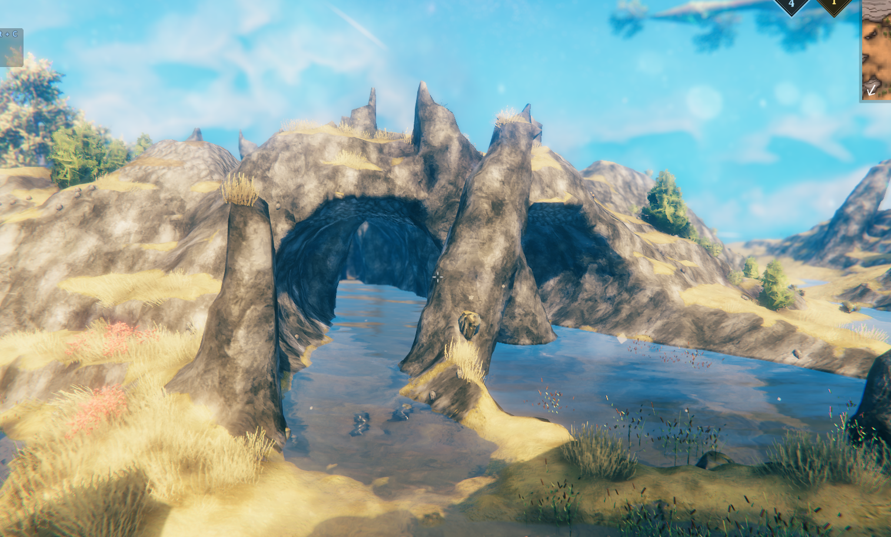
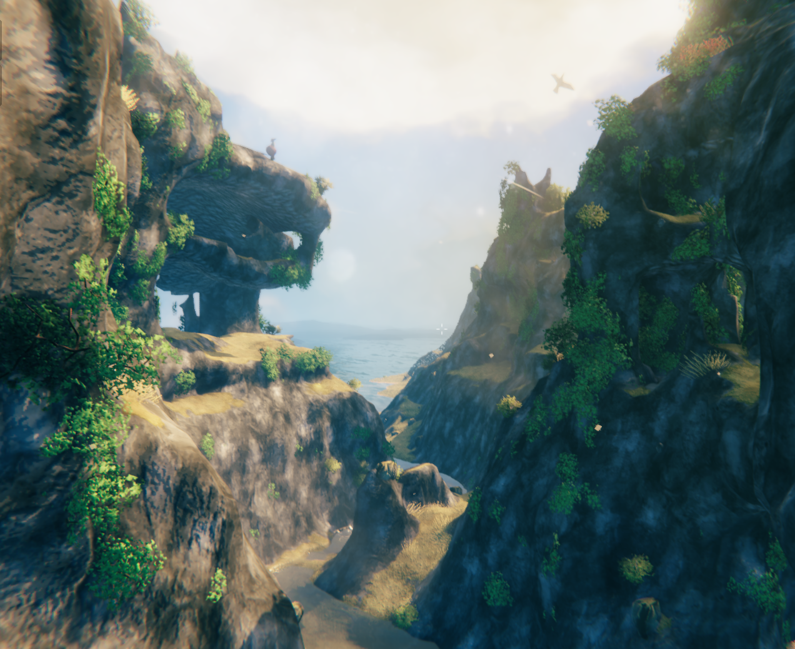
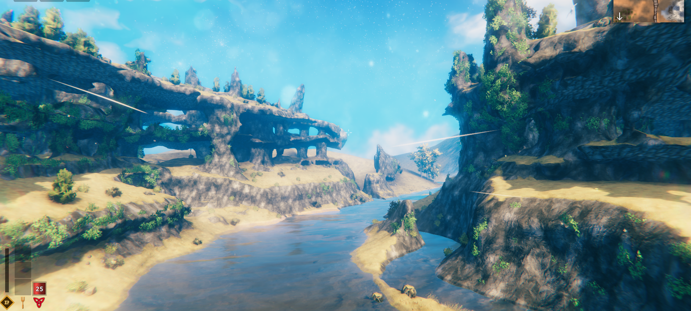
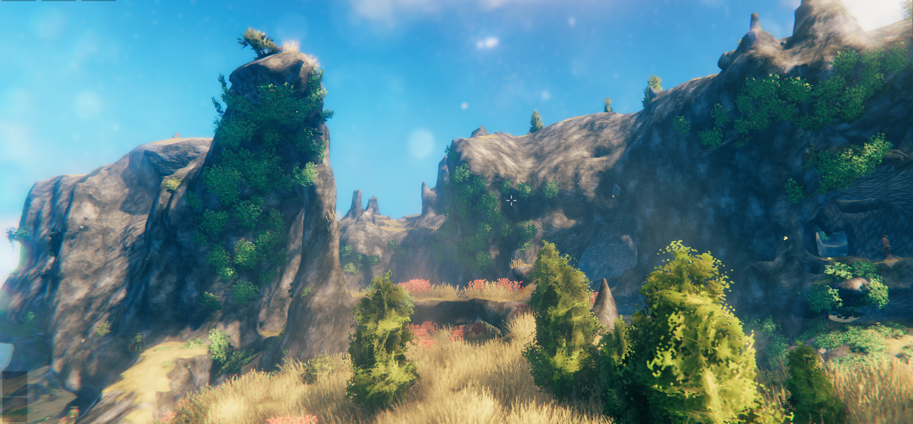
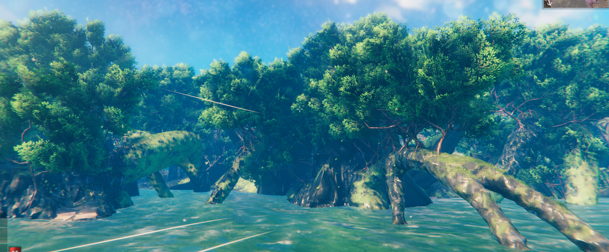

# ProceduralTerrain

> **Work in progress — 0.0.3 preview.** Novel terrain for the first six biomes by default. Generation, config, and bake format can still change between versions, so expect to start a new world and rebake when you upgrade. [Feedback welcome](https://discord.gg/vuHnDRqfjn).

A procedural terrain generator for Valheim, built on [Voxheim](https://thunderstore.io/c/valheim/p/Voxheim/Voxheim/). It replaces the vanilla heightmap with deterministic, fully three-dimensional voxel terrain — e.g. caves, overhangs, arches, canyons, canals — authored per biome through configurable noise profiles.










> **Upgrading to 0.0.3:** baking and the config files were overhauled. Delete your local `BepInEx/config/ProceduralTerrain/` configs so fresh copies regenerate, and start a new world. Rolling bake is on by default now — you can mostly ignore baking and just play.

## Configuration

ProceduralTerrain uses three config files in `BepInEx/config/ProceduralTerrain/`, each a different scope:

**`biomes.cfg` — the terrain shape.** The only config that changes the terrain itself, so it's **server-authoritative and bake-relevant**: a server imposes it on every client (everyone generates the same world), and the bake is keyed to a hash of it — edit the shape and you rebake.
- `[Mode:*]` — the terrain primitives (noise-based shaping operations)
- `[Profile:*]` + `[BiomeName]` — primitives combined into named profiles, one per biome
- `[Pipeline]` — the global order the modes run in
- `[Bake]` / `[Debug]` — parameters that affect the baked file (resolution, blending), and toggles for tuning terrain generation

**`placements.cfg` — what populates the world.** Additional placements layered on top of vanilla — ore, scenery, creatures, vegetation — leaving vanilla's own spawns in place; plus location protection. These take effect only as zones load for the first time, so edits apply to newly-entered areas, not ground you've already visited. **Server-authoritative but not hashed**: clients inherit the server's copy, applied live, never baked into the `.bin`.
- `[Vegetation]` — tree/bush placement and how it conforms to carved ground
- `[Location]` — keeps world locations at their vanilla positions and reachable
- `[CaveContent]` + `[Placement:*]` — rules for additional ore, scenery, and creature spawns

**`client.cfg` — local settings.** Runtime and display settings that don't affect the generated world. Not synced from a server and not part of the bake hash; parsed last, so local values take precedence.

## Baking

Generating terrain at full quality is expensive, so it can be baked to disk once and served back cheaply. Three ways to play:

- **Carve live** — defer baking and hot-reload terrain changes while tuning a world before a playthrough. This is for world authors, not a truly playable mode.
- **Rolling bake** — baking happens in the background as you move. It's resource-intensive and may not keep up with player movement, falling back to live carving as needed. The default, because it requires no preparation and works well most of the time. Press **F8** to toggle a panel showing its progress and framerate.
  - The `rollingfill` setting (off by default) lets the rolling bake keep working while you're idle, filling the entire map in the background — so one long session can bake a whole world to hand off.
- **Pre-bake** — bake the world, or a portion of it, ahead of time, for the best experience. A full world takes hours.

### Commands

```
pt_bake [radius] [player]  — bake terrain for a radius in metres; on a server, admin only.
                             'player' centres the disc on you instead of world origin.
pt_cancel                  — stop a running bake; zones finished so far are saved as a
                             valid partial bake.
pt_bakeinfo                — bake status: file, whether it's loaded/serving, rolling state.
pt_bakestats               — timing and resource stats from the last bake.
pt_bakemap [radius]        — render a PNG map of which zones are and aren't baked.
pt_listbakes [server]      — list local bake files and sizes; 'server' queries the server.
pt_bakereload              — reload the bake file without restarting (after uploading a
                             .bin to a running server).
pt_download                — download the server's bake for this world into your local one.
pt_clearbake [file|server] — delete a bake file (default: this world).
```

## Requirements

- [BepInExPack Valheim](https://thunderstore.io/c/valheim/p/denikson/BepInExPack_Valheim/)
- [Voxheim](https://thunderstore.io/c/valheim/p/Voxheim/Voxheim/)

## Thunderstore

https://thunderstore.io/c/valheim/p/ctogle/ProceduralTerrain/
